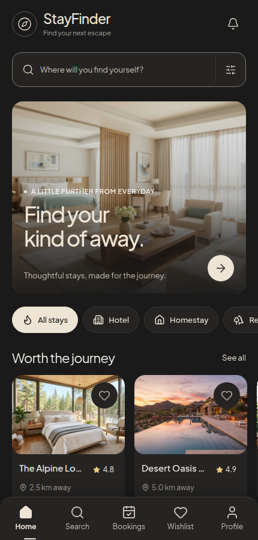
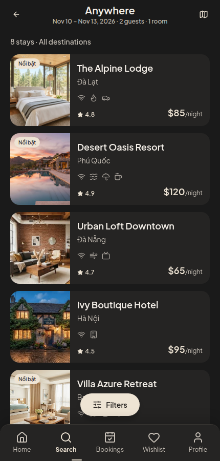
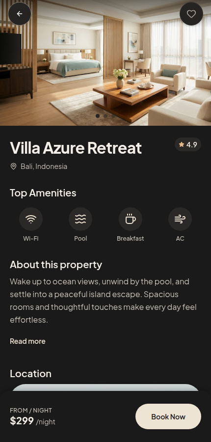

# StayFinder

StayFinder is a travel and accommodation app for discovering stays, comparing room options, saving favorites, and trying a booking flow. The repository contains an Expo React Native frontend and a Spring Boot API.

<p align="center">
  
  
  
</p>

<p align="center"><sub>Home · Search · Property details — screenshots from the web demo</sub></p>

## What you can explore

- Browse and search stays, filter results, compare room prices, and view property details.
- Save stays to a wishlist and try the guest details, booking, payment, and confirmation screens.
- View bookings, leave a review on a completed demo stay, and use demo reward points.

By default, the frontend runs an in-memory USD demo without a backend; its sign-in and payment screens are simulations. Set `EXPO_PUBLIC_API_BASE_URL` to use the PostgreSQL-backed API, which uses VND and SePay test-mode payments. See [Backend API mode](#backend-api-mode) for the connection steps.

## Project structure

| Directory | Stack | Purpose |
| --- | --- | --- |
| [`Frontend/`](Frontend/) | Expo, React Native, TypeScript, Expo Router | Mobile app and web demo |
| [`Backend/`](Backend/) | Java 21, Spring Boot, PostgreSQL | REST API, authentication, bookings, payments |

## Frontend preview

Use Node.js 22 or newer. From `Frontend/`:

```bash
npm ci
npm run web -- --host localhost --port 8081
```

Open [the web preview](http://localhost:8081). Expo updates the preview while source files change.

To check motion without Metro's development overhead, stop any server using port 8082 and run:

```bash
npm run preview
```

This exports and serves the production web app at [localhost:8082](http://localhost:8082), including room deep links. It binds only to the local machine. Rebuild/restart after source changes. The optional `?measureMotion=1` URL records five seconds of frame intervals and long tasks in the console; it does not measure native FPS or sustained interaction latency.

```bash
npm run typecheck
npm test
npx expo export --platform web
```

Without `EXPO_PUBLIC_API_BASE_URL`, the interactive frontend uses one USD demo catalog and shared session state for the booking draft, wishlist, bookings and reward balance. Refreshing the page resets this in-memory demo. Guest details are not put in URLs or browser storage. Authentication and payment in demo mode are simulations; no real payment or confirmation email is sent. Additional interface languages are marked as coming soon.

## Backend API mode

Copy `Frontend/.env.example` to `Frontend/.env` and set `EXPO_PUBLIC_API_BASE_URL` to a backend address reachable from the device. Restart Expo after changing it. For web, add the exact frontend origin to `CORS_ALLOWED_ORIGINS` in `Backend/.env` (the example includes local ports 8081 and 8082). The receiving account is configured once as `SEPAY_BANK_ACCOUNT_NUMBER` on the backend and returned with a payment. Keep database credentials and webhook secrets only in the backend environment.

API mode uses PostgreSQL-backed accounts, accommodations, room availability, wishlist, bookings, reviews and SePay payment status. Prices are displayed in VND. Booking creation is limited to one room; checkout creates a pending booking and SePay payment code, then waits for the signed webhook before showing confirmation. It does not offer the demo's card, wallet, reward redemption or external-provider quotes as real transactions. The JWT is kept in memory, so refreshing the app requires signing in again. Backend setup and the manual schema migration are in `Backend/README.md`. Live end-to-end testing requires a working PostgreSQL database and SePay sandbox configuration.

## Frontend implementation notes

The frontend uses neutral dark surfaces with warm ivory controls and bundled property photography. The web view stays within a 520 px app canvas on larger screens. Search retains the matching room tier when opening a result; bookings show the selected room and final amount. Reward redemptions and their history remain consistent while navigating within the session.

Home reveals sections and cards as they enter the viewport, with a slow hero photo drift that pauses offscreen. Screen entrances use a 560 ms transform/opacity transition; sheets use 480 ms in and 320 ms out. Shared motion honors reduced-motion preferences. Input outlines and keyboard focus rings separate controls from decorative borders, while completed/cancelled bookings keep their actions readable.

Frontend audit and measured bundle sizes: [2026-11-05 audit](Frontend/FRONTEND_AUDIT.md). Import Lucide icons through `Frontend/constants/icons.ts` and use per-family entries for Expo vector icons to avoid bundling unused icons/fonts. Booking summaries use the selected room's catalog photo, with a shared fallback when loading fails.

## Backend setup

Use Java 21 and a PostgreSQL database. From `Backend/`:

```bash
cp .env.example .env
# Replace the sample database connection and set JWT, CORS, and SePay test-mode values in .env
./mvnw spring-boot:run
```

Spring Boot reads `Backend/.env` locally and validates the database schema on startup; it does not create or migrate tables. Review the prerequisites and manual migration in [Backend/README.md](Backend/README.md) before starting against an existing database. Run backend tests with `./mvnw test` from `Backend/`.

## Manual frontend verification

<details>
<summary>Open the demo checklist</summary>

1. Open a Home card and confirm its name, image and price match the detail screen. Save it and check Wishlist; remove it and use Undo. An unknown property ID must show an unavailable state.
2. In Search, change destination, future dates, guests, rooms and filters. Cancel must discard unapplied changes; Apply must update results. Past dates cannot be selected. Check a date range crossing a month/year and room capacity limits.
3. Find Villa Azure Retreat, open Compare Prices and select StayFinder. Choose Premium Suite ($450 per night). For three nights and one room, the room subtotal must be $1,350 and the total with demo fees $1,485.
4. Enter test guest details. In checkout, redeem 2,500 points: the total must become $1,460. Confirm the demo booking. Confirmation and My Bookings must show the same room, dates, guests and amount. The reward balance must decrease only once.
5. Cancel the new reservation and verify it moves to Cancelled. Open the seeded completed stay, submit a rating/comment, then reopen the review to verify both were retained.
6. Check 320×568 and 390×844 viewports, large text, keyboard overlap and OS reduced motion. Buttons/hearts should respond without looping entrance animations; sheets should close smoothly and remain scrollable on small screens. Native Android/iOS and release performance still require device verification.
7. In Profile, open Settings → Change password, cancel, then open Report an Issue → Choose category and return to the report. Only one modal portal should remain active. In Search, switch between criteria, dates and guests: the outgoing sheet should finish closing before content/height changes, and Cancel should restore the previous draft. On web, sheets, buttons and hearts use CSS transform/opacity transitions; native motion uses the native Animated driver.
8. Open Home search, cancel, return Home and open it again: the sheet must reopen. Search for `Villa Azure` using the free-text destination action. Change dates/guest counts and cancel within each picker: the prior values must return. For four guests in one room, Villa Azure must display the $450 suite rate; a $350 maximum must exclude it. The Pool filter must include Desert Oasis Resort despite its Vietnamese amenity label.
9. Set the minimum search rate above $299 and below $450. Open Villa Azure: detail, Compare Prices and room selection must retain Premium Suite at $450. External providers must show no quote for this room rather than a cheaper quote for a different room.
10. Claim Free Breakfast in Rewards, leave for Profile and reopen the wallet. Both the 5,000-point debit and its history must remain. Repeated transaction IDs and insufficient balances are covered by the regression suite.
11. Repeat Profile → Rewards → Home three times. There must still be one Home instance and one tab navigator; existing SVG gradients must have unique IDs. The hero image must fill its frame, drift while visible and pause offscreen. Scroll to reveal cards, then return to a tab: content must finish fully visible. Select Hotel and See all: Search must retain the selected category.
12. At 320×568 and 390×844, check input outlines, keyboard focus, the Back button over a bright photo, Rewards' Earn More action, and Upcoming/Completed/Cancelled booking cards. Buttons must stay distinguishable without dimming whole cards. Reload `/room/select?id=villa-azure`: rooms must load without a hydration error or an unavailable-state flash.

</details>
